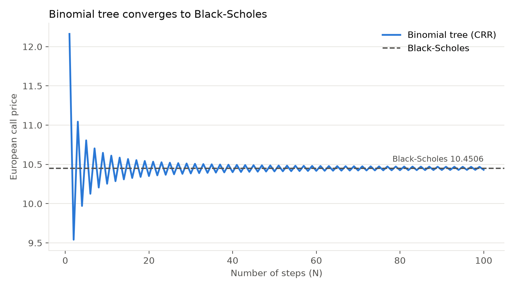
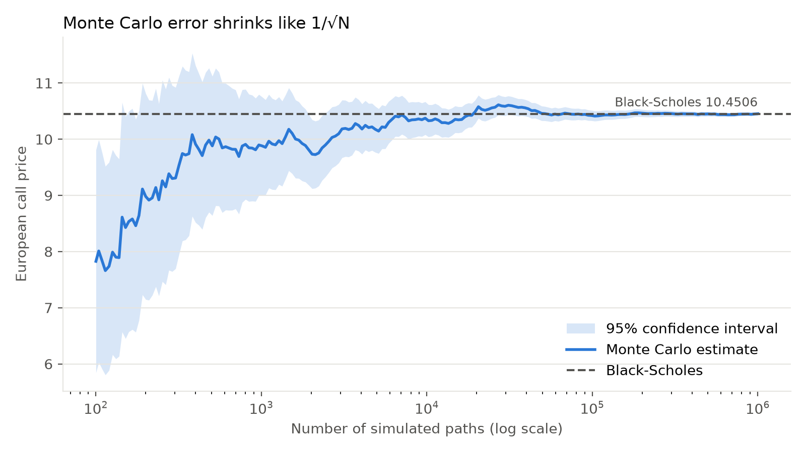
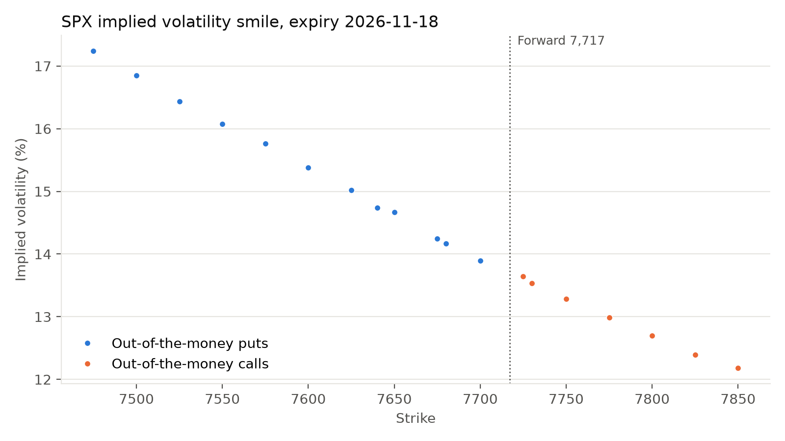

 
 


Readme · MD
# Option Pricer
 
A Python library for pricing options three independent ways (closed-form Black-Scholes, Cox-Ross-Rubinstein binomial trees and Monte Carlo simulation), with analytical Greeks and an implied volatility solver applied to live S&P 500 option data.
 
## Features
 
- European option prices with the Black-Scholes formula
- Analytical Greeks: delta, gamma, vega, theta and rho
- American options with a binomial tree, including early exercise
- Monte Carlo pricing with standard errors and confidence intervals
- Variance reduction with antithetic variates and control variates
- Arithmetic Asian options, priced by Monte Carlo against an exact geometric Asian control
- A safeguarded Newton-Raphson implied volatility solver
- A live implied volatility smile built from real S&P 500 option quotes
- 196 unit tests covering every module
## Results
 

 
The binomial tree price of an at-the-money call (S = K = 100, T = 1, r = 5%, σ = 20%) for 1 to 100 steps. It converges to the Black-Scholes price of 10.4506, zigzagging between odd and even step counts because the strike falls in a different place relative to the final nodes. The error shrinks roughly in proportion to 1/N, and at 1,000 steps it is about 0.002.
 

 
A Monte Carlo estimate of the same call as simulated paths are added, with its 95% confidence interval. The interval narrows in proportion to 1/√N, so each 100× increase in paths buys a 10× gain in accuracy. That slow rate is why variance reduction matters.
 

 
Implied volatility by strike for S&P 500 index options, using the first expiry at least 30 days out (a snapshot from the last time the script was run). If Black-Scholes were exactly right, every strike would show the same volatility. Instead, low-strike puts trade at much higher implied volatilities: the volatility skew. The market is pricing a fatter left tail than the normal distribution allows, reflecting persistent demand for crash protection.
 
## Methods
 
### Black-Scholes and Greeks
 
European options are priced with the closed-form Black-Scholes formula:
 
$$C = S\,N(d_1) - Ke^{-rT}N(d_2), \qquad d_1 = \frac{\ln(S/K) + (r + \tfrac{1}{2}\sigma^2)T}{\sigma\sqrt{T}}, \qquad d_2 = d_1 - \sigma\sqrt{T}$$
 
The Greeks are its partial derivatives, derived analytically. The identity $S\,\phi(d_1) = Ke^{-rT}\phi(d_2)$ cancels most of the terms produced by the chain rule, which is why delta reduces to $N(d_1)$ and vega to $S\,\phi(d_1)\sqrt{T}$.
 
Each Greek is checked three ways: against central finite differences of the pricing function, against the Black-Scholes PDE
 
$$\Theta + \tfrac{1}{2}\sigma^2S^2\Gamma + rS\Delta - rV = 0,$$
 
and against published textbook values.
 
### Binomial tree
 
The Cox-Ross-Rubinstein tree splits time into N steps of length Δt. At each step the stock moves up by $u = e^{\sigma\sqrt{\Delta t}}$ or down by $d = 1/u$, so the tree recombines and has only N + 1 final prices. Option values are worked backwards from expiry using the risk-neutral probability:
 
$$V = e^{-r\Delta t}\big[q\,V_u + (1-q)\,V_d\big], \qquad q = \frac{e^{r\Delta t} - d}{u - d}$$
 
For American options, each node takes the larger of this continuation value and the value of exercising immediately. Each time step is computed for all nodes at once with NumPy, so a 1,000-step American option prices in a few hundredths of a second.
 
The tree is validated by its convergence to Black-Scholes, by put-call parity (which holds exactly on the tree for any N), and by two no-arbitrage results: an American call on a non-dividend-paying stock equals the European call, and an American put is never worth less than the European put.
 
### Monte Carlo
 
Stock prices at expiry are simulated exactly under the risk-neutral measure:
 
$$S_T = S_0\exp\!\Big(\big(r - \tfrac{1}{2}\sigma^2\big)T + \sigma\sqrt{T}\,Z\Big), \qquad Z \sim N(0,1)$$
 
The price is the discounted average payoff, reported with its standard error so every estimate comes with a confidence interval.
 
Two variance reduction techniques are implemented:
 
- **Antithetic variates** pair each draw Z with −Z. For an at-the-money call this halves the variance at no extra cost. (For symmetric payoffs such as straddles it can increase variance, so it is optional.)
- **Control variates** price arithmetic Asian options, which have no closed form, alongside geometric Asian options, which do (Kemna and Vorst, 1990). Because the two payoffs are almost perfectly correlated, correcting the arithmetic estimate by the measured error in the geometric one cuts the standard error by about 36× for the same number of paths.
Path-dependent options are simulated on a grid of equally spaced dates (12 monthly averaging dates by default).
 
### Implied volatility
 
Implied volatility is the σ that makes the Black-Scholes price match a market price. The solver uses Newton-Raphson, with vega as the derivative, which converges quadratically. Plain Newton can diverge for out-of-the-money options, where the price curve is flat and a tangent step can overshoot wildly, so the solver:
 
- checks the price lies within the no-arbitrage bounds, so a solution exists;
- starts at the inflection point of price as a function of volatility (Manaster and Koehler, 1982);
- keeps a bracket around the answer and falls back to bisection whenever a Newton step would leave it.
To build the smile from live data, the forward price is inferred from put-call parity at strikes near spot,
 
$$F = K + e^{rT}(C - P),$$
 
and options are priced off that forward (equivalent to Black's 1976 model). This handles dividends without having to estimate them. Only out-of-the-money options are used, puts below the forward and calls above it, since in-the-money prices are dominated by intrinsic value. Quotes with no bid, crossed markets or very wide spreads are discarded. The risk-free rate is taken from the 13-week US Treasury bill yield.
 
## Project structure
 
```
option-pricer/
├── option_pricer/
│   ├── black_scholes.py     # closed-form prices
│   ├── greeks.py            # analytical Greeks
│   ├── binomial.py          # CRR binomial tree, European and American
│   ├── monte_carlo.py       # Monte Carlo, variance reduction, Asian options
│   ├── implied_vol.py       # safeguarded Newton-Raphson solver
│   └── smile.py             # implied forward and smile construction
├── tests/                   # pytest suite, one file per module
├── scripts/                 # chart generation, including the live smile
├── images/                  # charts used in this README
└── requirements.txt
```
 
## Installation
 
```bash
git clone https://github.com/Kbrown176/option-pricer.git
cd option-pricer
python3 -m venv .venv
source .venv/bin/activate
pip install -r requirements.txt
python -m pytest
```
 
## Usage
 
```python
from option_pricer.black_scholes import black_scholes
from option_pricer.greeks import delta
from option_pricer.binomial import binomial_tree
from option_pricer.monte_carlo import mc_asian
from option_pricer.implied_vol import implied_vol
 
black_scholes(100, 100, 1.0, 0.05, 0.20, "call")                    # 10.4506
delta(100, 100, 1.0, 0.05, 0.20, "call")                            # 0.6368
binomial_tree(100, 100, 1.0, 0.05, 0.20, N=1000,
              option_type="put", american=True)                      # 6.0896
mc_asian(100, 100, 1.0, 0.05, 0.20, control_variate=True, seed=0)   # 6.1561, SE 0.0008
implied_vol(10.4506, 100, 100, 1.0, 0.05, "call")                   # about 0.2000
```
 
To regenerate the charts:
 
```bash
python scripts/convergence_plot.py
python scripts/mc_convergence_plot.py
python scripts/vol_smile.py          # S&P 500 index options
python scripts/vol_smile.py AAPL     # or any ticker with listed options
```
 
## Testing
 
The suite has 196 tests, run with `python -m pytest`. They check that:
 
- each Greek matches a finite-difference derivative of the price, and together they satisfy the Black-Scholes PDE;
- the binomial tree converges to Black-Scholes, with error falling as steps increase, and respects put-call parity and the American option bounds;
- Monte Carlo prices fall within four standard errors of the exact answer, standard errors shrink like 1/√N, and the discounted stock price is a martingale (which fails if the drift correction is wrong);
- the geometric Asian formula reduces to Black-Scholes with a single averaging date, and the control variate agrees with plain Monte Carlo while cutting the error by more than 10×;
- implied volatility recovers the input volatility across a grid of strikes, maturities and volatility levels, and rejects prices outside the no-arbitrage bounds;
- the smile code recovers a known skew and dividend-adjusted forward from a synthetic option chain, and skips broken quotes.
Monte Carlo tests use fixed random seeds, so results are identical on every run. A further 14 implied volatility cases are skipped on purpose: they are deep in-the-money options with almost no time value, where the price barely depends on volatility and the implied volatility is not well defined.
 
## Limitations and extensions
 
- **Constant volatility.** Every model assumes a single σ, which the smile shows is not how markets price options. Local or stochastic volatility models (such as Heston) would capture the skew.
- **No dividends in the core models.** The live smile handles dividends through the implied forward, but the pricers themselves assume a non-dividend-paying stock.
- **Binomial oscillation.** The odd-even zigzag could be removed by averaging consecutive step counts or using the Leisen-Reimer tree.
- **Simplified market inputs.** Time to expiry is measured in calendar days over 365, the Treasury bill yield is a proxy for the rate the options market uses, and Yahoo Finance quotes can be delayed or noisy.
- **Possible extensions:** Garman-Kohlhagen pricing for FX options, Monte Carlo Greeks, American options by least-squares Monte Carlo, and a full volatility surface across expiries.
## References
 
- Black, F. (1976). The Pricing of Commodity Contracts. *Journal of Financial Economics*.
- Black, F. and Scholes, M. (1973). The Pricing of Options and Corporate Liabilities. *Journal of Political Economy*.
- Cox, J., Ross, S. and Rubinstein, M. (1979). Option Pricing: A Simplified Approach. *Journal of Financial Economics*.
- Kemna, A. and Vorst, A. (1990). A Pricing Method for Options Based on Average Asset Values. *Journal of Banking and Finance*.
- Manaster, S. and Koehler, G. (1982). The Calculation of Implied Variances from the Black-Scholes Model. *Journal of Finance*.
- Glasserman, P. (2003). *Monte Carlo Methods in Financial Engineering*. Springer.
- Hull, J. *Options, Futures, and Other Derivatives*. Pearson.
## Author
 
Killian Brown | [LinkedIn](https://linkedin.com/in/killian-brown)
 
